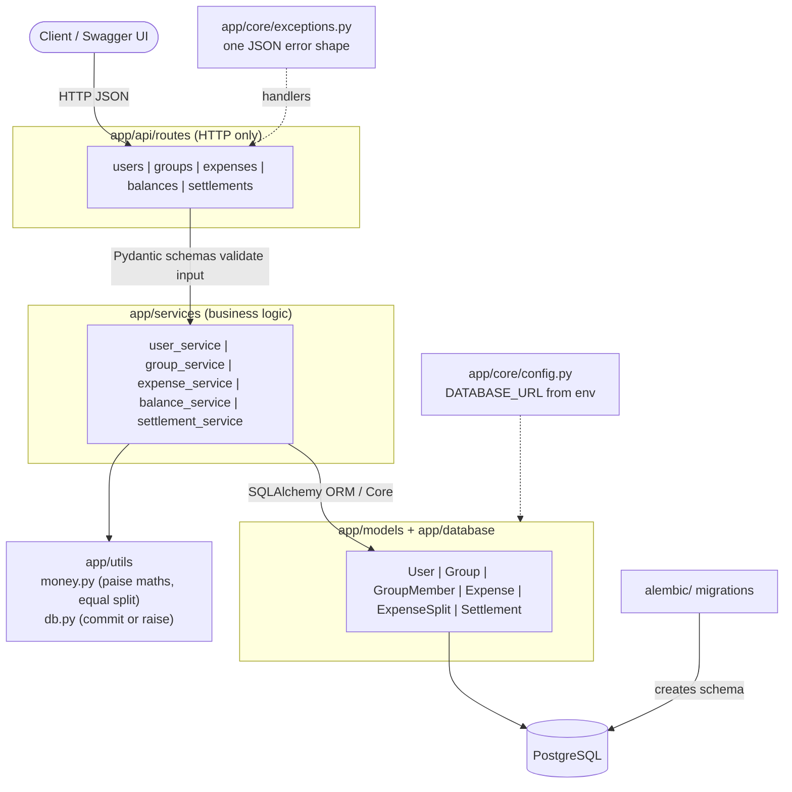
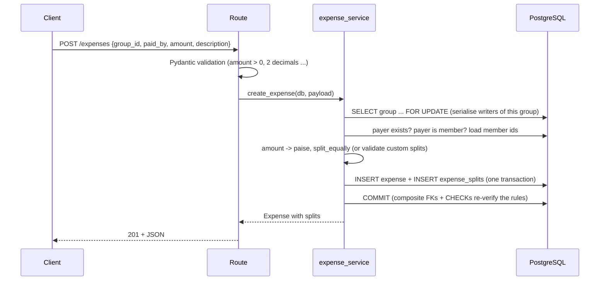

# Architecture

The service is a classic layered FastAPI application. HTTP concerns, business rules and data
access are kept in separate modules, and the pure algorithms contain no I/O so they can be
unit-tested directly.



## Layers

| Layer | Location | Responsibility |
|---|---|---|
| Routes | `app/api/routes/` | Parse the request, call one service function, shape the response. No business logic. |
| Schemas | `app/schemas/` | Pydantic request / response models and validation (non-empty names, amount > 0, <= 2 decimals, either `participants` or `splits`). |
| Services | `app/services/` | Business rules: membership checks, split calculation, balance engine, settlement algorithm, transactions. |
| Models | `app/models/` | SQLAlchemy tables with all constraints. |
| Database | `app/database/` | Engine / session factory and the `get_db` request dependency. |
| Core | `app/core/` | Settings (environment variables) and the error-handling strategy. |
| Utils | `app/utils/` | Integer-paise money helpers, `commit_or_raise` transaction helper. |

There is no separate repository layer: with six tables, the SQLAlchemy queries sit next to the
rules that use them and a repository would only forward calls.

## Request flow: `POST /expenses`



Any failure before `COMMIT` leaves nothing behind; a failure *during* `commit_or_raise` rolls the
whole transaction back and returns a safe 409/500 error (the raw database error is only logged).

## Error handling

Every failure uses one body shape, produced in `app/core/exceptions.py`:

```json
{"error": {"code": "NOT_FOUND", "message": "Group 999 not found"}}
```

| Situation | Status | `code` |
|---|---|---|
| Malformed / invalid input (Pydantic) | 422 | `VALIDATION_ERROR` (with per-field `details`) |
| Unknown group / user | 404 | `NOT_FOUND` |
| Duplicate membership / duplicate user name | 409 | `CONFLICT` |
| Well-formed request that breaks a rule (payer not in group, splits do not add up, over-settlement) | 422 | `BUSINESS_RULE_VIOLATION` |
| Database failure / anything unexpected | 500 | `DATABASE_ERROR` / `INTERNAL_ERROR` (generic message, details only in logs) |

## Concurrency

Creating an expense and recording a repayment both depend on the group's current ledger, so they
first take `SELECT ... FOR UPDATE` on the group row. Two simultaneous repayments against a debt that
can only be settled once therefore cannot both succeed (verified against PostgreSQL with 12
parallel requests: exactly one `201`, eleven `422`). SQLite ignores row locks; it is only used for
quick local test runs.

## Deployment

`docker compose up --build` starts `db` (PostgreSQL 16, with a health check) and `api`
(which waits for the database to be healthy, runs `alembic upgrade head`, then starts uvicorn).
