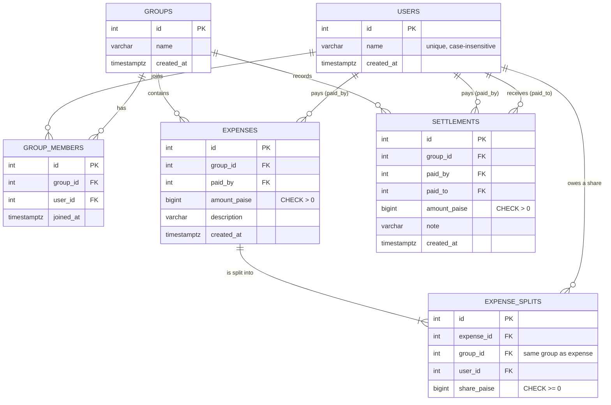

# Database schema

PostgreSQL 16, managed by Alembic (`alembic/versions/0001_initial_schema.py`).
The migration is verified by a test that upgrades an empty database, compares the
result with the SQLAlchemy models (zero differences) and downgrades again.

## Entity relationship diagram

## Tables

### `users`
A person. `name` is the public handle used in the `/balances` and expense responses
(`{"Rahul": {"owes": {"Mohit": 400}}}`), so it must identify one person: a unique index
on `lower(name)` rejects `Mohit` / `mohit` duplicates.

### `groups`
A set of people sharing expenses (a trip, a flat, ...).

### `group_members`
Which user belongs to which group (many-to-many between `users` and `groups`).
* `UNIQUE (group_id, user_id)` - a user cannot be added to the same group twice.
* Index on `user_id` for "which groups is this user in".
* This table is also the target of the *composite foreign keys* below, which turn
  "must be a member of the group" into a database guarantee.

### `expenses`
One payment made by one member for the group.
* `amount_paise BIGINT CHECK (amount_paise > 0)`: money is an **integer number of paise**
  (1 INR = 100 paise); there is no floating point and no `NUMERIC` rounding anywhere.
* `FOREIGN KEY (group_id, paid_by) -> group_members (group_id, user_id)`: the payer must be a
  member of the expense's group.
* `UNIQUE (id, group_id)`: lets `expense_splits` reference the pair (see below).
* Index `(group_id, created_at)` for the expense history of a group.

### `expense_splits`  (additional table)
One row per participant: how much of the expense that user is responsible for.
It is written **once, when the expense is created**, and never recomputed. That is why a
member who joins the group later is not charged for earlier expenses: balances are built from
these rows, not from current membership.
* `share_paise BIGINT CHECK (share_paise >= 0)` (a share can be 0 when a tiny amount is split
  between many people, e.g. 1 paisa between 3).
* `UNIQUE (expense_id, user_id)` - one share per participant per expense.
* `FOREIGN KEY (expense_id, group_id) -> expenses (id, group_id)` and
  `FOREIGN KEY (group_id, user_id) -> group_members (group_id, user_id)`: the split belongs to the
  same group as its expense, and the participant is a member of that group.
  `group_id` is therefore stored redundantly (a deliberate, constraint-backed denormalisation).
* The payer has a row too (their own share). Their own share is *not* a debt: the balance engine
  ignores rows where `user_id = expenses.paid_by`.

### `settlements`  (optional bonus)
A real repayment: `paid_by` gave `paid_to` money. Append-only history; expenses are never edited
or deleted to simulate a repayment.
* `CHECK (amount_paise > 0)`, `CHECK (paid_by <> paid_to)`.
* Both users must be members of the group (two composite foreign keys).

## Why plain foreign keys *and* composite ones?
`expenses.paid_by -> users.id` states the relationship; `(group_id, paid_by) -> group_members`
states the *rule* (payer is in the group). The composite key already implies the user exists, but
keeping both makes the schema easy to read and makes the simple relationship explicit.

## Referential actions
* Children of a group (`group_members`, `expenses`, `settlements`) `ON DELETE CASCADE` from `groups`;
  `expense_splits` cascade from `expenses`.
* References to `users` and to group membership are `ON DELETE RESTRICT`: a user who has paid or
  owes money can never be silently removed. (The API has no delete endpoints.)

## Rules enforced by the database vs. by the application

| Rule | Enforced by |
|---|---|
| No duplicate membership | `UNIQUE (group_id, user_id)` |
| Unique user names (case-insensitive) | unique index on `lower(name)` |
| Amount > 0, share >= 0, no self repayment | `CHECK` constraints |
| Payer / participant / repayer belongs to the group | composite foreign keys |
| Split row belongs to its expense's group | composite foreign key |
| Splits add up to the expense amount | application (service layer, same transaction) |
| Repayment does not exceed what is owed | application (service layer, row-locked) |

"Splits add up to the amount" cannot be a plain `CHECK` (it spans rows). It is enforced in
`expense_service.calculate_shares` before the single commit; a database constraint trigger would be a
possible hardening step.

## Indexes
`uq_users_name_lower`, `uq_group_members_group_user`, `ix_group_members_user_id`,
`ix_expenses_paid_by`, `ix_expenses_group_id_created_at`, `uq_expenses_id_group_id`,
`uq_expense_splits_expense_user`, `ix_expense_splits_user_id`, `ix_settlements_paid_by`,
`ix_settlements_paid_to`, `ix_settlements_group_id_created_at`, plus all primary keys.

## Money representation
Stored as integer paise. The API accepts rupees as a JSON number with at most two decimals
(`1200`, `19.99`; anything finer is rejected) and returns rupees as a JSON number (`400`, `33.34`).
The request is parsed into `Decimal` and converted to integer paise immediately; all arithmetic is
integer arithmetic. A float only appears when an already-exact paise value is written to JSON.
